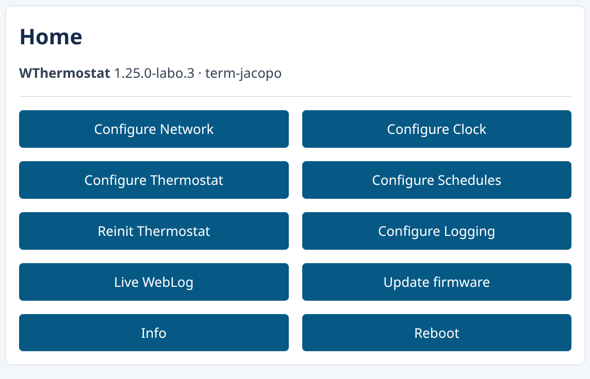
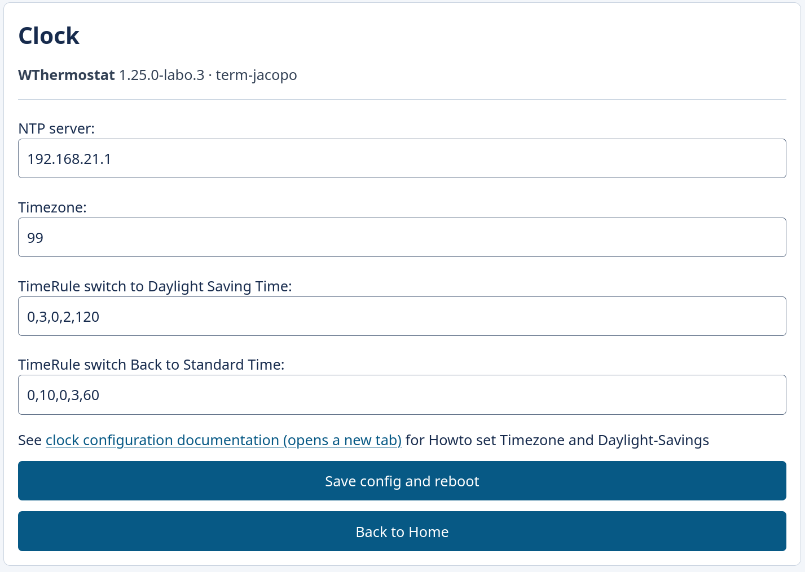
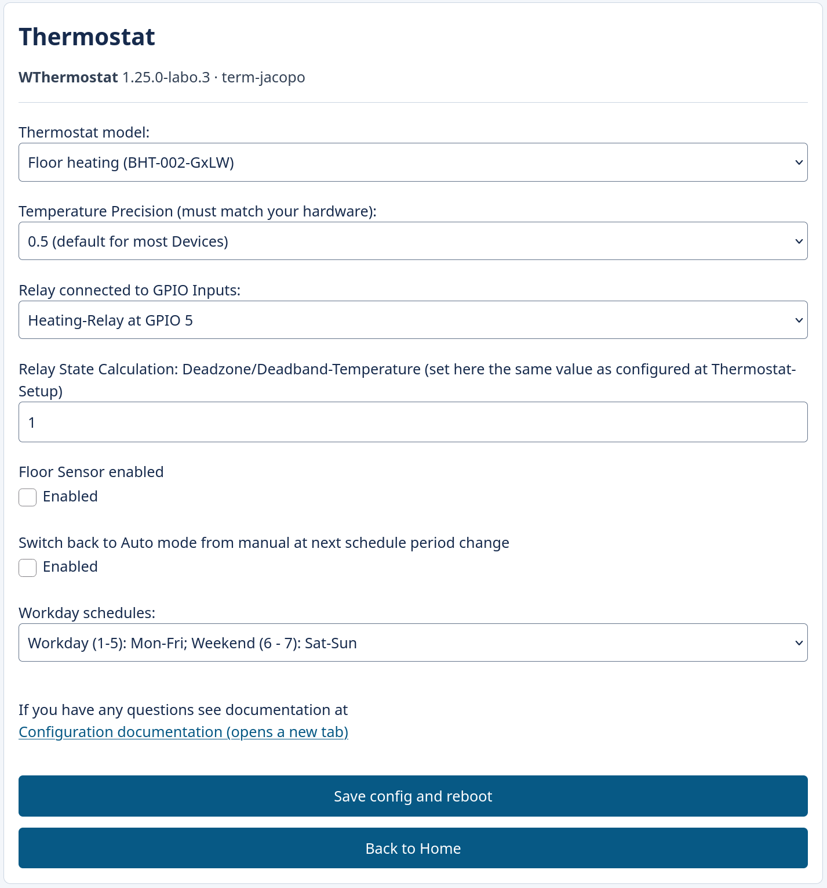
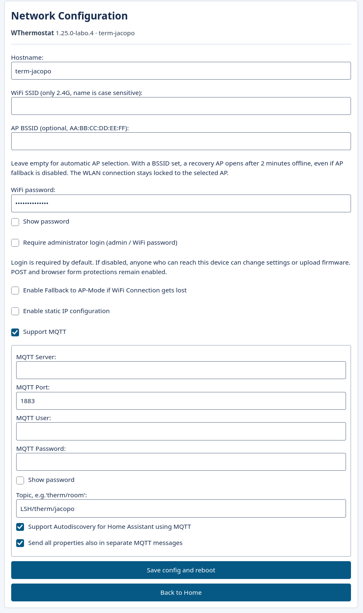
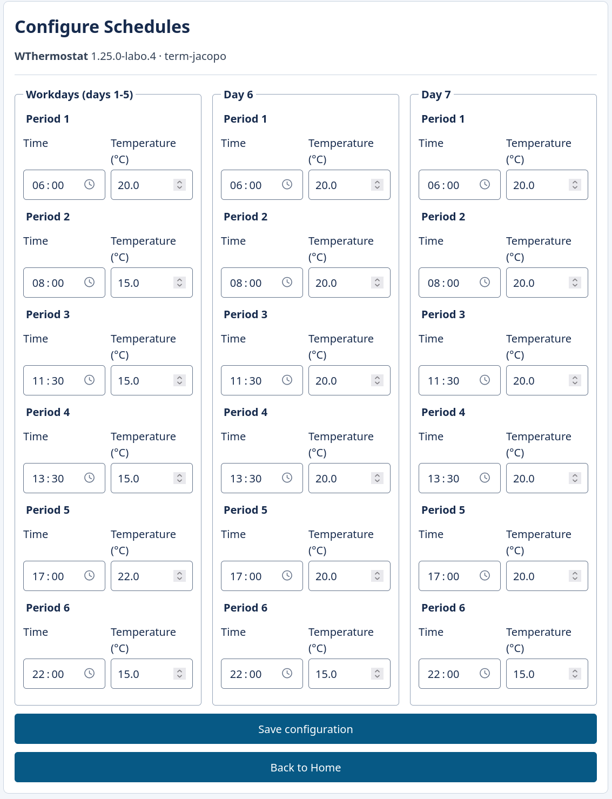

# WThermostatBeca-labo

**WThermostat-Labo** is local-control firmware for compatible **ESP8266 Beca/Moes/Qiumi Wi-Fi thermostats**, without a Tuya cloud dependency. This is the maintenance fork of [fashberg/WThermostatBeca](https://github.com/fashberg/WThermostatBeca), originally based on [klausahrenberg/WThermostatBeca](https://github.com/klausahrenberg/WThermostatBeca).

**Current stable release: [v1.27.1](https://github.com/labodj/WThermostatBeca-labo/releases/tag/v1.27.1).** See GitHub Releases for changes, firmware downloads and upgrade notes.

[](https://github.com/labodj/WThermostatBeca-labo/actions/workflows/build.yml)
[](https://github.com/labodj/WThermostatBeca-labo/releases)

## What changed in 1.27.1

- The web interface displays **WThermostat-Labo**. Info links to the GitHub repository and issues; the firmware-update page links to releases. Branding does not change stored names, MQTT topics or discovery identifiers.
- **Resync thermostat** replaces the immediate Reinit action in Home and Live WebLog. The first click opens an explanation; **Confirm resync** sends the protected action, while **Cancel** returns Home without starting it. This works without JavaScript.
- Silent WebLog correctly reports **Web logging is disabled.** Other levels describe the selected logging threshold.
- Main, Clock and Thermostat section headings are centered in Info; individual labels remain left-aligned.

## Reliability and configuration

The transport, authentication and persistence improvements introduced in 1.27.0 remain in place:

- Digest challenges are tied to this boot, expire after five minutes, and reject reused counters and mismatched request targets. A small replay window allows parallel browser requests and repeated callbacks within one upload.
- Network forms save legacy fields, BSSID and long credentials in one checked EEPROM commit. Device forms also batch their writes. Failed commits return an error without scheduling a reboot and restore the previous in-memory settings.
- MQTT JSON commands remain intact when MQTT logging publishes from the command callback. Known values are validated before applying a batch, including fields that may become writable when ECO changes.
- WebThings JSON responses stream with checked writes; allocation failures or responses above 8 KiB return HTTP 503 rather than a truncated HTTP 200 response. BAC state descriptions include cooling/fan states; BHT descriptions remain heating-only.
- DST offsets are checked each clock tick, even if the loop misses the exact transition second. Periodic state publication also survives the roughly 49.7-day millisecond-counter rollover.
- Flash-format logging avoids an extra 256-byte stack buffer; unused network timers are removed.
- CSS and JavaScript are served directly from flash. HTML response creation checks its actual buffer size and memory reserve before allocation, and handles unavailable response objects.
- HTML pages also use checked formatting and writes: an incomplete form is discarded and returns HTTP 503. HTML pages use bounded 256-byte blocks and release consumed blocks while sending, avoiding large contiguous allocations and copy-before-free growth on fragmented heaps. Live WebLog queues are limited to four messages; messages are skipped while memory is low or a browser cannot keep up. MQTT logging remains independent.
- HTTP header parsing checks memory before allocating header storage. HTML pages release validated request headers and preserve RAM for TCP, preventing the low-memory crash reproduced with WebLog and concurrent page loads. When several large transfers exceed available memory, the device can return HTTP 503; retry after the other transfer finishes. A three-device test with Info, WebLog and one configuration tab found one initial cold-cache Wi-Fi page returning 503 on the device using Verbose logging; the retry and four later cold reloads passed without a reboot. This transient remains a known limitation, not a claimed fix.
- POST forms include their protection token in the server-generated HTML, so saving does not depend on JavaScript loading. Flash-backed assets use a 1 KiB admission reserve for response objects and headers; their checked transport buffers can wait for memory to become available.
- HTTP responses retain pending bytes until TCP accepts them. The server dependency is pinned to the [upstream premature-close fix](https://github.com/ESP32Async/ESPAsyncWebServer/commit/c764160d875a7a97a2d9463edff90b8a705a89df); regression tests force partial writes, including one byte at a time. The global WebLog handler is registered without transferring its ownership to the server. The pinned web server fork explicitly copies temporary HTTP and handshake buffers into ESP8266 TCP storage, keeping retransmissions valid after the response releases its buffers. Empty TCP outputs remain pollable, so a temporary send-buffer allocation failure can recover instead of waiting for a nonexistent ACK.

ESPAsyncWebServer is pinned to the [labodj integration branch](https://github.com/labodj/ESPAsyncWebServer/tree/codex/firmware-integration), based on upstream commit `340c93fb108451022a8791e8be295e7b181cf9f4`. It includes the independent fixes proposed in upstream PRs [#509](https://github.com/ESP32Async/ESPAsyncWebServer/pull/509) and [#510](https://github.com/ESP32Async/ESPAsyncWebServer/pull/510), plus the ESP8266 guard before STL header allocation. Upstream allocation checks and the static 100 Continue response are retained.

The common JavaScript is 504 bytes (previously 1,363): protection tokens come from the server, and unused helpers have been removed. Transport fixes live in versioned library forks with regression tests; experimental TCP counters and snapshots are removed. Table headings and buttons use explicit semantics, and restart status pages offer manual navigation instead of a timed refresh.

Stored offsets, device IDs, discovery IDs and existing configuration choices are retained. After a reported write failure, autosaves are blocked until a complete Network Configuration save succeeds. A single-sector EEPROM commit is **not power-loss atomic**: keep power connected during saves, and investigate a storage error before rebooting or retrying. Tests simulate write failures; they cannot prove physical flash reliability.

## Get the firmware

| File in the release | Purpose |
|---|---|
| **[`wthermostat-1.27.1.bin`](https://github.com/labodj/WThermostatBeca-labo/releases/download/v1.27.1/wthermostat-1.27.1.bin)** | Normal firmware for a supported thermostat; use this image for an ordinary upgrade. |
| `wthermostat-1.27.1.bin.gz` | The same image compressed for OTA paths that support gzip; not for direct serial flashing. |
| `wthermostat-minimal-1.27.1.bin` / `.bin.gz` | Temporary OTA bridge when space is insufficient. It has **no thermostat control, MQTT or clock**; replace it with normal firmware afterwards. |
| `wthermostat-symbols-1.27.1.zip` | Matching normal ELF/MAP files for diagnosis, not a flash image. |
| `SHA256SUMS`, `BUILD-MANIFEST.json`, `SOURCE-MANIFEST.json` | Artifact checksums, build/image validation and source provenance. |

The normal image is built for **ESP8266, 1 MiB flash, DOUT, 40 MHz flash / 80 MHz CPU**. Check the hardware before installation. Debug firmware is for development boards only: its UART log output conflicts with the thermostat MCU. It is not published as an installable thermostat image.

Verify downloaded files from their directory:

```sh
sha256sum --ignore-missing -c SHA256SUMS
```

## Hardware compatibility

These families were supported or reported working by the original projects; that history does **not** mean every revision has been tested with this release:

| Family | Historical variants | Controller profile |
|---|---|---|
| BHT-002 | GALW, GBLW, GCLW | Heating |
| BHT-3000 / BTH-3000L | GALW/ABLW, GBLW, GCLW | Heating |
| BHT-6000 | GALW, GBLW, GCLW | Heating |
| BAC-002-ALW / BAC-1000-ALW | Wi-Fi air-conditioning variants | Heating, cooling, ventilation |

The module must actually be **ESP8266** and use the compatible MCU protocol. A product name or Wi-Fi suffix alone does not identify the module; offline, Zigbee, ESP32 and other chip variants are not targets of this image. GA/GB/GC describe different output arrangements; select the correct device profile and retain the manufacturer's wiring specification.

The ESP8266 communicates with the thermostat's separate MCU over UART. This firmware updates the ESP8266, **not** the MCU firmware. Temperature sensing, display, relay control and scheduling remain constrained by the MCU and device model. Reported `action` can be calculated rather than measured relay feedback.

Historical hardware references: [installation](Installation.md), [first-flash guide](Flashing.md), [hardware diagram](docs/images/how-it-works.png). Those older guides are references for the original hardware, not proof that a particular current Tuya device supports their conversion method.

## What this fork provides

- Local web configuration, schedules, clock diagnostics, firmware updates and live logs.
- MQTT state/control, retained state and availability, and Home Assistant discovery.
- Read-only WebThings access and authenticated property writes.
- NTP, timezone/DST rules and existing MCU time/calibration workarounds.
- Optional Wi-Fi BSSID lock, preserved across reconnections, with fault-triggered recovery AP alongside the station connection.
- Long Wi-Fi passwords and temporary local login recovery through the thermostat panel's Wi-Fi setup function.
- Optional administrator authentication (enabled by default), POST/CSRF protections and per-request HTTP buffers.
- Consistent automatic/manual, ECO and BAC state reporting, including power and mode changes without a new temperature reading.
- Bounded schedule, UART, JSON and MQTT parsing, corrected resource ownership and numeric serialization.
- Vendored WAdapter, pinned build dependencies, sanitizer-backed regression tests and repeatable static analysis.

BAC adds system/fan modes; BHT can expose an enabled external floor sensor. Available settings and entities depend on the chosen profile and hardware.

## First installation and setup

If WThermostat is already installed, use the upgrade section below. For a stock Tuya device, the available first-flash method depends on its module and existing firmware; the historical tuya-convert instructions are not a universal OTA installation method. Serial installation requires access to the compatible module and the original hardware precautions in [Flashing.md](Flashing.md).

On initial setup:

1. Connect to the configuration AP, normally named `WThermostat-<chip-id>`, using AP password `12345678`.
2. Open `http://192.168.4.1/` if the captive portal does not open automatically.
3. Save the 2.4 GHz Wi-Fi connection and obtain the thermostat's address from your router.
4. Open `http://<device-ip>/`, then configure the correct thermostat profile, temperature precision, clock and schedules.
5. Configure MQTT and Home Assistant discovery if required.

The AP password and the administrative web password are different roles. After Wi-Fi is configured, administration requires login by default: **username `admin` and the saved Wi-Fi password**. The login requirement can be disabled explicitly in Network Configuration. MQTT keeps its separately configured broker credentials.

Initial provisioning is accessible before a Wi-Fi configuration exists. An automatic recovery AP keeps administrator login enabled. Since v1.25.0-labo.5, a physical Wi-Fi setup request opens a five-minute local recovery window; see the recovery instructions below. More background: [configuration guide](Configuration.md); the authentication and recovery instructions apply to this release.

## Upgrade an existing thermostat

1. Keep a copy of the previous firmware and record the current model/settings.
2. Download the **normal BIN** above, verify its checksum, and use the thermostat's web firmware-update page. Keep power connected and check the displayed OTA capacity.
3. After reboot, reload the page and sign in with `admin` and the configured Wi-Fi password.
4. Verify model, Wi-Fi/MQTT, time, schedules and Home Assistant availability on the physical device.

A reset is not required for the legacy fashberg settings layouts covered by the tests: legacy field offsets, individual field sizes and version flags are preserved. The BSSID remains in its existing EEPROM tail slot; long Wi-Fi passwords use a checked extension after the original 512-byte area. AP fallback is enabled once on migration; your later choice is retained. Version 1.26.0-labo also preserves the longer hostname, MQTT username/password and base topic from recognized older layouts using a checked extension starting at EEPROM offset 640. Existing application settings are read during supported migration. A failed extension save blocks settings writes instead of saving truncated values. This does not reconstruct values already lost by an earlier firmware or guarantee migration from an unknown layout.

If the normal image cannot fit, the minimal image is a temporary bridge, not a usable thermostat firmware. Complete the second upgrade to normal firmware. Compressed OTA is available where the update path supports it. Local size calculations and valid image checksums are not a physical OTA test.

## Administration and security

| Interface | Access |
|---|---|
| Web configuration, info, firmware update and live log | HTTP Digest by default: `admin` / saved Wi-Fi password; optional login setting |
| Configuration, reset and MCU reinitialization | POST; login when enabled, browser forms always include CSRF protection |
| WebThings property reads | Anonymous read-only GET |
| WebThings property writes | PUT; HTTP Digest when login is enabled |
| MQTT | Existing broker credentials and broker access policy |

**Require administrator login** in Network Configuration controls web, OTA, WebThings writes and WebSocket log access. It defaults to enabled for existing valid configurations; old forms without the new option preserve the current choice. Disabling it lets anyone who can reach the device administer it and upload firmware. POST, Origin and configuration-form CSRF checks remain active; MQTT credentials are unaffected. Saving the setting restarts the device. Enabling login with an empty Wi-Fi password is rejected before settings are changed.

Since v1.25.0-labo.5, the firmware supports Wi-Fi passphrases of **8–63 bytes**, including spaces and punctuation, or a **64-digit hexadecimal PSK**. HTTP Digest explicitly declares UTF-8 for non-ASCII passwords; the access point must support the same password bytes. Empty passwords are supported for open Wi-Fi with administrator login disabled. Existing credentials are preserved. Uncheck **Keep saved WiFi password** to replace a password, or leave it checked when changing other network settings. Passwords are not included in the configuration page source.

Long Wi-Fi passwords use a checked extension of the existing EEPROM area. All legacy configuration fields and BSSID addresses stay in place. Hostnames and MQTT usernames now support **32 bytes**; MQTT passwords and base topics support **64 bytes**. MQTT has its own **Keep saved MQTT password** checkbox: uncheck it to change or clear the saved value, including setting the literal password `___NOCHANGE___`.

Back up network values before downgrading. Firmware without these extensions cannot preserve long values; change them to values supported by the destination firmware first. The original limits were 16 bytes for hostname/MQTT username and 32 bytes for Wi-Fi password/MQTT password/base topic.

**Forgotten administrator password (full firmware, v1.25.0-labo.5 and later):** use the thermostat's physical Wi-Fi setup gesture. On supported Beca controllers, hold Down while the thermostat is off, or Power + Down while it is on, until Wi-Fi setup is requested (typically around eight seconds; the gesture depends on the model). Join `WThermostat-<chip-id>` with AP key `12345678` and open `http://192.168.4.1`. For five minutes, requests received on that AP can change network/login settings without the forgotten administrator password. Disable **Require administrator login** while keeping the saved Wi-Fi password, or enter replacement Wi-Fi credentials, then save. Other settings are retained. The normal LAN interface does not gain this bypass; automatic fallback and MQTT AP commands do not enable it. Anyone nearby who knows the AP key can use this physically activated window. Minimal firmware has no thermostat-button recovery because it omits the MCU integration.

HTTP Digest authenticates requests but **does not encrypt HTTP traffic**. Use a trusted network. Do not expose the thermostat's administration directly to the Internet. Password values are not written to diagnostic logs.

The command-line OTA uploader prompts for the password; it does not take a password argument. Replace the documentation address `192.0.2.10` with the device address:

```sh
python pio/espupload.py --host 192.0.2.10 --file wthermostat-1.27.1.bin
```

For unattended use, supply `WTHERMOSTAT_PASSWORD` through an appropriate protected environment. No device address is configured as a default upload destination.

## Optional BSSID lock and recovery

In **Network Configuration**, leave **AP BSSID** empty for automatic AP selection, or enter a unicast MAC such as `02:11:22:33:44:55` to select one AP. The lock applies to initial connection and reconnections. The channel remains automatic, so that AP can change channel. BSSID selection is not an authentication boundary.

SDK autoconnection is disabled before station startup; automatic reconnection is enabled after the saved credentials and BSSID are passed to Wi-Fi. While connected, the firmware also checks the BSSID reported by the SDK and reconnects if it differs from the saved lock. This check is deferred during OTA uploads.

Since v1.25.0-labo.5, **AP fallback is enabled once on migration**, including configurations imported from fashberg and earlier labo releases. Subsequent changes to that option are retained. Existing network, MQTT, clock, thermostat and schedule settings are preserved. No recovery AP opens on a healthy startup.

With AP fallback enabled, a recovery AP opens after **120 seconds continuously offline**. A BSSID lock enables this offline recovery even if the fallback checkbox is off. Reconnection attempts continue alongside the AP and always retain the configured BSSID. An automatic recovery AP still requires administrator login when enabled.

For a static IP, fallback also checks the configured gateway on the local LAN using ARP. A persistent failure opens the recovery AP even when Wi-Fi association succeeds. Internet, DNS, MQTT and Home Assistant availability are not used as health checks. Existing ARP cache entries can delay detection; a reachable gateway cannot prove that every client can reach the thermostat or detect every IP conflict. New static configurations reject inconsistent subnet masks, off-subnet gateways, network/broadcast addresses and an IP equal to the gateway before saving.

The automatic AP normally uses `192.168.4.1`; if that subnet overlaps the station network, it selects `172.31.255.1` or `10.255.255.1`. Join the AP with key `12345678`; its captive DNS points to the recovery address. The normal/minimal recovery window lasts **five minutes** (two in debug builds); opening Network Configuration through that AP refreshes it. After the window expires, the AP closes and a persistent fault can reopen it after another two minutes. Settings and BSSID remain saved. OTA activity defers recovery mode changes. The physical setup gesture provides the separate AP-only recovery path described above, independent of the configured static IP.

Recovery timing, saved configuration and authentication boundaries have host regression tests. Radio behavior, button gestures and browser login across devices still require testing on each supported thermostat model.

## Home Assistant

Use MQTT discovery rather than copying the old `climate: - platform: mqtt` examples.

1. Add/configure the [MQTT integration](https://www.home-assistant.io/integrations/mqtt/) in Home Assistant under **Settings → Devices & services**, connecting it to your broker.
2. Configure the thermostat to use that same broker and enable MQTT and Home Assistant discovery in Network Configuration.
3. Use the supported defaults: discovery prefix **`homeassistant`** and Home Assistant Birth topic **`homeassistant/status`** with payload **`online`**. Custom prefixes/Birth topics are not automatically detected by this firmware.
4. Check the MQTT device/entities in Home Assistant. Climate availability also waits for a complete valid MCU state, avoiding incomplete startup readings.

Discovery includes climate, schedules/diagnostics and the applicable optional floor-temperature entity. Existing supported entity IDs are retained. The firmware republishes discovery and retained state after MQTT reconnection and supported HA Birth events, retries failed discovery and clears obsolete configurations. A thermostat reboot is not required for every HA restart.

Broker persistence remains useful for retained messages across broker restarts, but does not replace correct broker/thermostat connectivity. Consult the [MQTT discovery documentation](https://www.home-assistant.io/integrations/mqtt/#mqtt-discovery) for Home Assistant's behavior. Configure broker settings according to its own documentation; there is no universal legacy `mqtt: broker:` YAML block to paste into modern Home Assistant.

| Profile | HVAC modes | Presets |
|---|---|---|
| BHT heating | `off`, `heat`, `auto` | `none`, `away` |
| BAC air conditioning | `off`, `heat`, `cool`, `fan_only` | `none`, `away`, `scheduler` |

BAC scheduling is a preset/hold state, not automatic selection between heating and cooling. Entity precision and optional features follow the device profile. The release is checked with **Home Assistant 2026.10.4**: two official-schema tests cover 126 discovery payloads, expansion, templates and negative cases. This is version-specific software evidence, not certification for every future HA release or every physical thermostat.

If manual entities are needed, use the current [MQTT climate documentation](https://www.home-assistant.io/integrations/climate.mqtt/) and the actual topics/properties below. Avoid configuring duplicate manual and discovered entities unintentionally.

## MQTT and WebThings API

Let `<base>` be the MQTT topic configured on the thermostat, for example `home/room`.

| Topic | Direction / purpose |
|---|---|
| `<base>/stat/things/thermostat/properties` | Retained thermostat state |
| `<base>/cmnd/things/thermostat/properties` | Empty payload requests state; a JSON object changes properties |
| `<base>/cmnd/things/thermostat/properties/<property>` | Change one writable property |
| `<base>/stat/things/thermostat/schedules` | Schedule report |
| `<base>/cmnd/things/thermostat/schedules` | Empty payload requests schedules; JSON changes entries |
| `<base>/tele/LWT` | Retained Wi-Fi/MQTT availability: `Online` / `Offline` |
| `<base>/tele/mcu` | Retained MCU readiness used by discovery |
| `<base>/tele/log` | Diagnostic log, when enabled |

Read-only request example:

```sh
mosquitto_pub -h mqtt.example.test -t home/room/cmnd/things/thermostat/properties -n
mosquitto_sub -h mqtt.example.test -t home/room/stat/things/thermostat/properties -v
```

Replace `mqtt.example.test` with your broker and supply its required authentication using your client configuration. Writable examples below **change thermostat operation**:

```sh
mosquitto_pub -h mqtt.example.test -t home/room/cmnd/things/thermostat/properties \
  -m '{"targetTemperature":22.0,"mode":"heat"}'
```

Common state properties include `temperature`, `targetTemperature`, `deviceOn`, `schedulesMode`, `ecoMode`, `locked`, `mode`, `preset` and `action`. BAC additionally exposes `systemMode` and `fanMode`; floor temperature depends on BHT configuration. The legacy scheduling alias `holdState` is MQTT-only. Use the selected device's WebThings description for its actual properties and allowed values. `action` is read-only. While ECO is enabled, `targetTemperature` is also read-only: the ECO setpoint is reported and the previous manual setpoint is retained. Internally refreshed targets do not switch the MCU out of automatic mode. A real target-temperature command outside ECO switches automatic scheduling to manual and sends both the mode and temperature commands.

Schedules use six periods in each of three day groups (`w`, `a`, `u`); group interpretation follows the configured schedule day offset. A partial update has the form:

```json
{"w1h":"06:00","w1t":20.0,"w2h":"08:00","w2t":17.0}
```

Time strings must be valid `HH:MM`, entries must remain ordered, and temperatures must satisfy configured bounds/precision. The sixth/final period may use `00:00` to mean the end of the schedule day; it becomes active at midnight and carries into the next day until that day's first period. Other reversed periods are rejected before being applied.

Read-only HTTP endpoints include:

```text
GET /things/thermostat
GET /things/thermostat/properties
GET /things/thermostat/schedules
```

Property writes use HTTP Digest PUT on the property endpoints. WebThings gateway behavior depends on its support for that authentication; this release does not provide a remote-access cloud service.

## Screenshots

| Home | Clock |
| --- | --- |
|  |  |

| Thermostat | Network |
| --- | --- |
|  |  |



These screenshots show earlier labo builds, before the WThermostat-Labo display branding and Resync confirmation page. The current Network Configuration page also has **Keep saved WiFi password** and **Keep saved MQTT password** checkboxes.

## Build and test

The ESP8266 TCP dependency is the minimal [labodj/ESPAsyncTCP maintenance fork](https://github.com/labodj/ESPAsyncTCP), pinned to a full commit SHA. Its lifetime, accepted-byte and pending-output fixes are tested in that repository. ESPAsyncWebServer is also pinned to a full commit SHA in the integration fork. Builds do not patch either dependency.

Digest and HTTP transport integration tests require the pinned ESPAsyncWebServer sources, installed by the commands below. They exercise its Digest verifier and actual send-buffer code, including partial TCP writes and retrying data sources.

The validated development host is **Linux x86_64, Python 3.14** (CI uses 3.14.10), with g++/ASan/UBSan, Node.js for JavaScript checks, and PlatformIO **6.2.0**. Other hosts need a compatible toolchain override in `platformio_override.ini`. WAdapter is already included in the repository; no submodule initialization is required.

```sh
git clone https://github.com/labodj/WThermostatBeca-labo.git
cd WThermostatBeca-labo
python3.14 -m venv .venv
. .venv/bin/activate
python -m pip install -r requirements-dev.txt
pio pkg install -e wthermostat
python -m unittest discover -s tests -v
pio run -e wthermostat
```

The normal image is written to `build_output/firmware/wthermostat-1.27.1.bin`; matching ELF/MAP files are in `build_output/map/`. An optional `platformio_override.ini` can change local settings; copying the sample also overrides `appversion`, so remove or edit that sample value if you want the release filename.

| PlatformIO environment | Purpose |
|---|---|
| `wthermostat` | Normal thermostat firmware, default |
| `wthermostat-minimal` | Temporary network/update bridge |
| `wthermostat-debug` | Development board only, UART logging |

```sh
# All variants, without uploading
pio run -e wthermostat -e wthermostat-minimal -e wthermostat-debug

# CI's packaged Clang check, with parser errors rejected
python pio/check.py

# Broad host Clang/Cppcheck and target GCC cross-checks
python pio/analyze.py
```

The broad analysis needs host Clang/Cppcheck; optional Python analyzers are pinned in `requirements-analysis.txt` and should be installed separately. It records commands, tool versions and raw reports under `build_output/validation/static/`. Clang uses an asserted ESP8266 data model; real firmware compilation uses the pinned **Xtensa GCC 10.3** recommended for the selected core, while host tests have also been checked with GCC 16.2. Do not substitute the host compiler for the target compiler.

Run the official HA validation in a separate Python 3.14 environment:

```sh
python3.14 -m venv /tmp/wthermostat-ha-tests
/tmp/wthermostat-ha-tests/bin/python -m pip install -r requirements-homeassistant-test.txt
/tmp/wthermostat-ha-tests/bin/python tests/homeassistant_schema.py
```

The release has **104 native tests**, run locally at 64/32 bit with address/undefined-behavior sanitizers, plus two official HA tests and three firmware builds. The regressions cover UART command ordering, scheduling across midnight, ECO/BAC state, legacy configuration/identity migration, credential edge cases and documented timezone transitions.

GitHub Actions runs native tests, firmware builds and the packaged static check, with HA schemas in a separate job. Release packaging validates the normal/minimal ESP8266 image headers and checksums, checks gzip round trips, and includes normal symbols plus source/build manifests. Debug firmware stays in CI artifacts and is excluded from the installable release assets. Tagged push builds prepare a draft release package after both succeed; publishing and physical qualification are separate steps. Build artifacts are available from the [workflow runs](https://github.com/labodj/WThermostatBeca-labo/actions/workflows/build.yml). The tagged workflow can also be dispatched explicitly. Local compilation is the validated starting point; old Gitpod instructions are not required.

## Reporting a problem

Include the release/tag, exact thermostat model and Wi-Fi module, selected controller profile, and whether the failure affects web, MQTT, MCU communication or recovery. Share redacted diagnostics and expected/observed behavior. Do not include Wi-Fi/MQTT passwords or unredacted configuration screenshots. Report problems in [this fork's issues](https://github.com/labodj/WThermostatBeca-labo/issues).

Upstream lineage and retained notices: [WAdapter provenance](lib/WAdapter/UPSTREAM.md). The proprietary MCU and hardware remain outside this firmware's control; software tests do not replace physical qualification.
