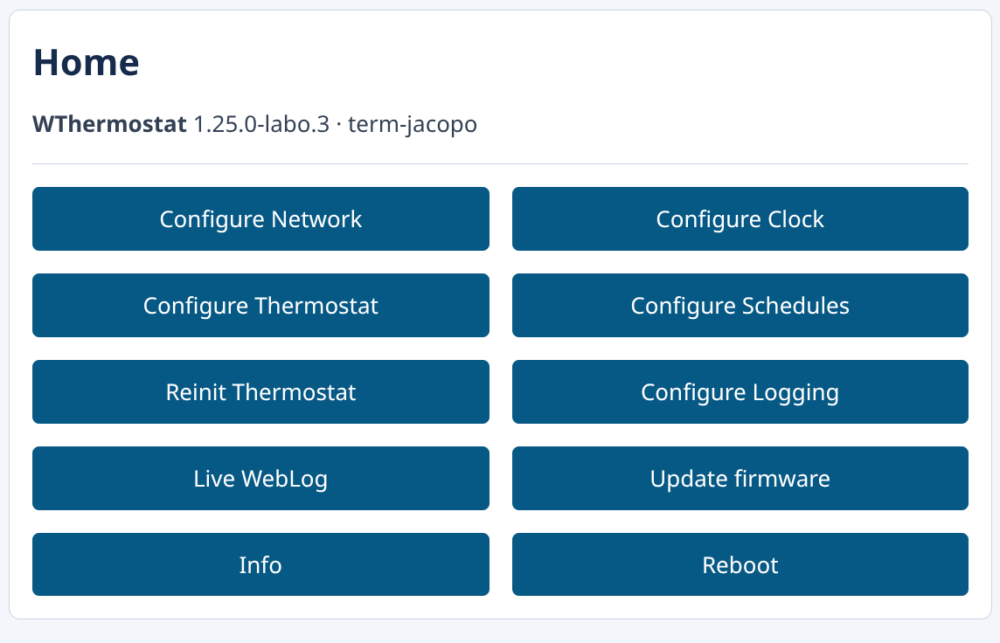
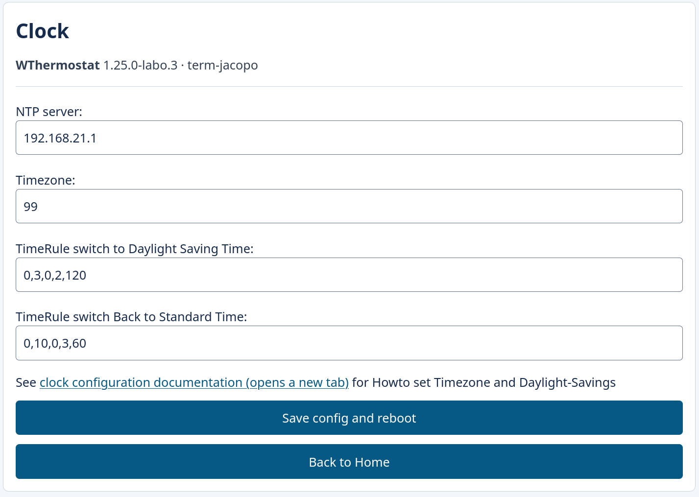
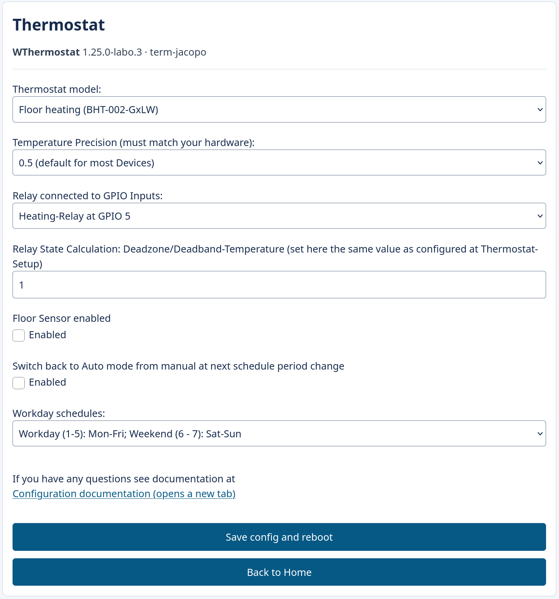
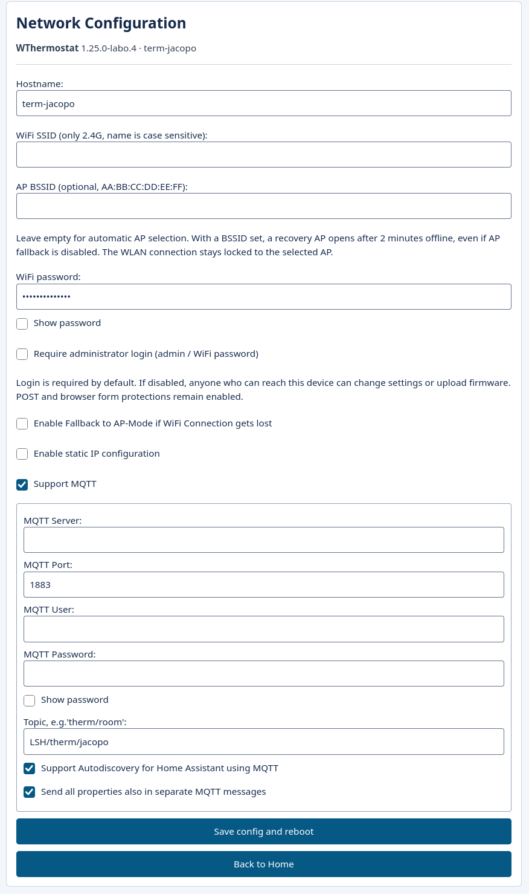
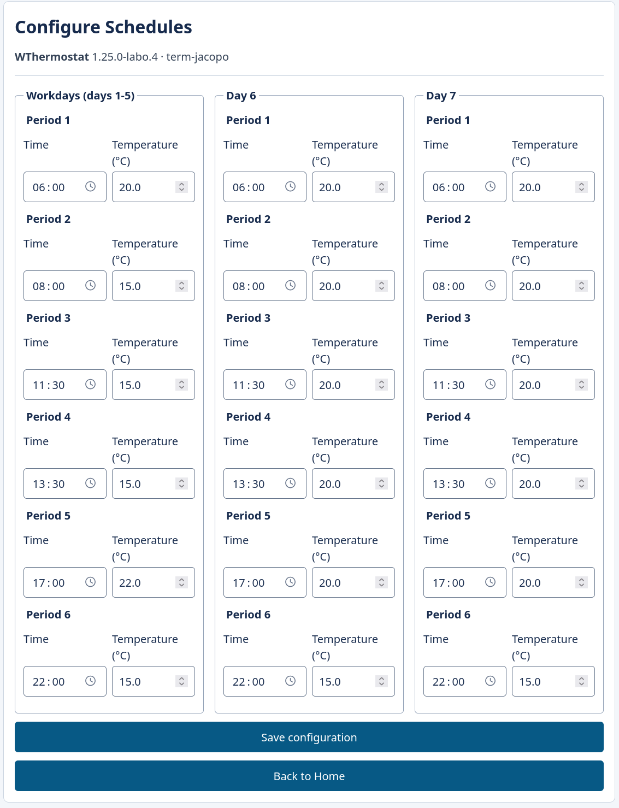

# WThermostatBeca-labo

Local-control firmware for compatible **ESP8266 Beca/Moes/Qiumi Wi-Fi thermostats**, without a Tuya cloud dependency. This is the maintenance fork of [fashberg/WThermostatBeca](https://github.com/fashberg/WThermostatBeca), originally based on [klausahrenberg/WThermostatBeca](https://github.com/klausahrenberg/WThermostatBeca).

**Current pre-release: [v1.25.0-labo.4](https://github.com/labodj/WThermostatBeca-labo/releases/tag/v1.25.0-labo.4).** See GitHub Releases for changes, firmware downloads and upgrade notes.

[](https://github.com/labodj/WThermostatBeca-labo/actions/workflows/build.yml)
[](https://github.com/labodj/WThermostatBeca-labo/releases)

## Get the firmware

| File in the release | Purpose |
|---|---|
| **[`wthermostat-1.25.0-labo.4.bin`](https://github.com/labodj/WThermostatBeca-labo/releases/download/v1.25.0-labo.4/wthermostat-1.25.0-labo.4.bin)** | Normal firmware for a supported thermostat; use this image for an ordinary upgrade. |
| `wthermostat-1.25.0-labo.4.bin.gz` | The same image compressed for OTA paths that support gzip; not for direct serial flashing. |
| `wthermostat-minimal-1.25.0-labo.4.bin` / `.bin.gz` | Temporary OTA bridge when space is insufficient. It has **no thermostat control, MQTT or clock**; replace it with normal firmware afterwards. |
| `wthermostat-symbols-1.25.0-labo.4.zip` | Matching normal ELF/MAP files for diagnosis, not a flash image. |
| `SHA256SUMS`, `BUILD-MANIFEST.json`, `SOURCE-MANIFEST.json` | Artifact checksums, build/image validation and source provenance. |

The normal image is built for **ESP8266, 1 MiB flash, DOUT, 40 MHz flash / 80 MHz CPU**. Check the hardware before installation. Debug firmware is for development boards only: its UART log output conflicts with the thermostat MCU. It is not published as an installable thermostat image.

Verify downloaded files from their directory:

```sh
sha256sum -c SHA256SUMS
```

## Hardware compatibility

These families were supported or reported working by the original projects; that history does **not** mean every revision has been tested with this release:

| Family | Historical variants | Controller profile |
|---|---|---|
| BHT-002 | GALW, GBLW, GCLW | Heating |
| BHT-3000 / BTH-3000L | GALW/ABLW, GBLW, GCLW | Heating |
| BHT-6000 | GALW, GBLW, GCLW | Heating |
| BAC-002-ALW / BAC-1000-ALW | Wi-Fi air-conditioning variants | Heating, cooling, ventilation |

The module must actually be **ESP8266** and use the compatible MCU protocol. A product name or Wi-Fi suffix alone does not identify the module; offline, Zigbee, ESP32 and other chip variants are not targets of this image. GA/GB/GC describe different output arrangements; select the correct device profile and retain the manufacturer's wiring specification.

The ESP8266 communicates with the thermostat's separate MCU over UART. This firmware updates the ESP8266, **not** the MCU firmware. Temperature sensing, display, relay control and scheduling remain constrained by the MCU and device model. Reported `action` can be calculated rather than measured relay feedback.

Historical hardware references: [installation](Installation.md), [first-flash guide](Flashing.md), [hardware diagram](docs/images/how-it-works.png). Those older guides are references for the original hardware, not proof that a particular current Tuya device supports their conversion method.

## What this fork provides

- Local web configuration, schedules, clock diagnostics, firmware updates and live logs.
- MQTT state/control, retained state and availability, and Home Assistant discovery.
- Read-only WebThings access and authenticated property writes.
- NTP, timezone/DST rules and existing MCU time/calibration workarounds.
- Optional Wi-Fi BSSID lock, preserved across reconnections, with timed recovery AP.
- Optional administrator authentication (enabled by default), POST/CSRF protections and per-request HTTP buffers.
- Bounded schedule, UART, JSON and MQTT parsing, corrected resource ownership and numeric serialization.
- Vendored WAdapter, pinned build dependencies, sanitizer-backed regression tests and repeatable static analysis.

BAC adds system/fan modes; BHT can expose an enabled external floor sensor. Available settings and entities depend on the chosen profile and hardware.

## First installation and setup

If WThermostat is already installed, use the upgrade section below. For a stock Tuya device, the available first-flash method depends on its module and existing firmware; the historical tuya-convert instructions are not a universal OTA installation method. Serial installation requires access to the compatible module and the original hardware precautions in [Flashing.md](Flashing.md).

On initial setup:

1. Connect to the configuration AP, normally named `WThermostat-<chip-id>`, using AP password `12345678`.
2. Open `http://192.168.4.1/` if the captive portal does not open automatically.
3. Save the 2.4 GHz Wi-Fi connection and obtain the thermostat's address from your router.
4. Open `http://<device-ip>/`, then configure the correct thermostat profile, temperature precision, clock and schedules.
5. Configure MQTT and Home Assistant discovery if required.

The AP password and the administrative web password are different roles. After Wi-Fi is configured, administration requires login by default: **username `admin` and the saved Wi-Fi password**. The login requirement can be disabled explicitly in Network Configuration. MQTT keeps its separately configured broker credentials.

Initial provisioning is accessible before a Wi-Fi configuration exists. When administrator login is enabled, a fallback AP with saved credentials does not bypass it. An explicitly requested setup AP provides the existing passwordless-configuration recovery path. More background: [configuration guide](Configuration.md); its legacy screenshots and authentication descriptions may differ from this release.

## Upgrade an existing thermostat

1. Keep a copy of the previous firmware and record the current model/settings.
2. Download the **normal BIN** above, verify its checksum, and use the thermostat's web firmware-update page. Keep power connected and check the displayed OTA capacity.
3. After reboot, reload the page and sign in with `admin` and the configured Wi-Fi password.
4. Verify model, Wi-Fi/MQTT, time, schedules and Home Assistant availability on the physical device.

A reset is not required for the legacy fashberg settings layouts covered by the tests: field offsets, sizes and version flags are preserved. The BSSID extension uses previously unused EEPROM tail bytes. Much older upstream layouts may follow their existing migration path; do not assume every setting from every historic firmware will survive.

If the normal image cannot fit, the minimal image is a temporary bridge, not a usable thermostat firmware. Complete the second upgrade to normal firmware. Compressed OTA is available where the update path supports it. Local size calculations and valid image checksums are not a physical OTA test.

## Administration and security

| Interface | Access |
|---|---|
| Web configuration, info, firmware update and live log | HTTP Digest by default: `admin` / saved Wi-Fi password; optional login setting |
| Configuration, reset and MCU reinitialization | POST; login when enabled, browser forms always include CSRF protection |
| WebThings property reads | Anonymous read-only GET |
| WebThings property writes | PUT; HTTP Digest when login is enabled |
| MQTT | Existing broker credentials and broker access policy |

**Require administrator login** in Network Configuration controls web, OTA, WebThings writes and WebSocket log access. It defaults to enabled for existing valid configurations; old forms without the new option preserve the current choice. Disabling it lets anyone who can reach the device administer it and upload firmware. POST, Origin and configuration-form CSRF checks remain active; MQTT credentials are unaffected. Saving the setting restarts the device. Enabling login with an empty Wi-Fi password is rejected before settings are changed.

This switch must be changed while you can still access the device. It is not an anonymous password-reset endpoint; if login is enabled and the Wi-Fi password is lost, recover the password or use an authorized physical recovery/reflash procedure.

HTTP Digest authenticates requests but **does not encrypt HTTP traffic**. Use a trusted network. Do not expose the thermostat's administration directly to the Internet. Password values are not written to diagnostic logs.

The command-line OTA uploader prompts for the password; it does not take a password argument. Replace the documentation address `192.0.2.10` with the device address:

```sh
python pio/espupload.py --host 192.0.2.10 --file wthermostat-1.25.0-labo.4.bin
```

For unattended use, supply `WTHERMOSTAT_PASSWORD` through an appropriate protected environment. No device address is configured as a default upload destination.

## Optional BSSID lock and recovery

In **Network Configuration**, leave **AP BSSID** empty for automatic AP selection, or enter a unicast MAC such as `02:11:22:33:44:55` to select one AP. The lock applies to initial connection and reconnections. The channel remains automatic, so that AP can change channel. BSSID selection is not an authentication boundary.

If the locked AP is unavailable for **120 seconds continuously**, a recovery AP opens even when ordinary AP fallback is disabled. The normal/minimal configuration window lasts **five minutes**; opening Network Configuration refreshes it. Change or clear the BSSID, and update SSID/password if replacing an AP. If administrator login is enabled, saved credentials still protect the web interface.

When the window expires, the firmware retries the locked AP and repeats recovery if necessary. The lock is never silently removed. Manual setup requests take priority; OTA activity defers mode changes. Info shows both the configured lock and connected AP BSSID. Physical radio/failure recovery remains a hardware qualification item.

## Home Assistant

Use MQTT discovery rather than copying the old `climate: - platform: mqtt` examples.

1. Add/configure the [MQTT integration](https://www.home-assistant.io/integrations/mqtt/) in Home Assistant under **Settings → Devices & services**, connecting it to your broker.
2. Configure the thermostat to use that same broker and enable MQTT and Home Assistant discovery in Network Configuration.
3. Use the supported defaults: discovery prefix **`homeassistant`** and Home Assistant Birth topic **`homeassistant/status`** with payload **`online`**. Custom prefixes/Birth topics are not automatically detected by this firmware.
4. Check the MQTT device/entities in Home Assistant. Climate availability also waits for a complete valid MCU state, avoiding incomplete startup readings.

Discovery includes climate, schedules/diagnostics and the applicable optional floor-temperature entity. Existing supported entity IDs are retained. The firmware republishes discovery and retained state after MQTT reconnection and supported HA Birth events, retries failed discovery and clears obsolete configurations. A thermostat reboot is not required for every HA restart.

Broker persistence remains useful for retained messages across broker restarts, but does not replace correct broker/thermostat connectivity. Consult the [MQTT discovery documentation](https://www.home-assistant.io/integrations/mqtt/#mqtt-discovery) for Home Assistant's behavior. Configure broker settings according to its own documentation; there is no universal legacy `mqtt: broker:` YAML block to paste into modern Home Assistant.

| Profile | HVAC modes | Presets |
|---|---|---|
| BHT heating | `off`, `heat`, `auto` | `none`, `away` |
| BAC air conditioning | `off`, `heat`, `cool`, `fan_only` | `none`, `away`, `scheduler` |

BAC scheduling is a preset/hold state, not automatic selection between heating and cooling. Entity precision and optional features follow the device profile. The release is checked with **Home Assistant 2026.10.4**: two official-schema tests cover 126 discovery payloads, expansion, templates and negative cases. This is version-specific software evidence, not certification for every future HA release or every physical thermostat.

If manual entities are needed, use the current [MQTT climate documentation](https://www.home-assistant.io/integrations/climate.mqtt/) and the actual topics/properties below. Avoid configuring duplicate manual and discovered entities unintentionally.

## MQTT and WebThings API

Let `<base>` be the MQTT topic configured on the thermostat, for example `home/room`.

| Topic | Direction / purpose |
|---|---|
| `<base>/stat/things/thermostat/properties` | Retained thermostat state |
| `<base>/cmnd/things/thermostat/properties` | Empty payload requests state; a JSON object changes properties |
| `<base>/cmnd/things/thermostat/properties/<property>` | Change one writable property |
| `<base>/stat/things/thermostat/schedules` | Schedule report |
| `<base>/cmnd/things/thermostat/schedules` | Empty payload requests schedules; JSON changes entries |
| `<base>/tele/LWT` | Retained Wi-Fi/MQTT availability: `Online` / `Offline` |
| `<base>/tele/mcu` | Retained MCU readiness used by discovery |
| `<base>/tele/log` | Diagnostic log, when enabled |

Read-only request example:

```sh
mosquitto_pub -h mqtt.example.test -t home/room/cmnd/things/thermostat/properties -n
mosquitto_sub -h mqtt.example.test -t home/room/stat/things/thermostat/properties -v
```

Replace `mqtt.example.test` with your broker and supply its required authentication using your client configuration. Writable examples below **change thermostat operation**:

```sh
mosquitto_pub -h mqtt.example.test -t home/room/cmnd/things/thermostat/properties \
  -m '{"targetTemperature":22.0,"mode":"heat"}'
```

Common state properties include `temperature`, `targetTemperature`, `deviceOn`, `schedulesMode`, `ecoMode`, `locked`, `mode`, `preset` and `action`. BAC additionally exposes `systemMode` and `fanMode`; floor temperature depends on BHT configuration. The legacy scheduling alias `holdState` is MQTT-only. Use the selected device's WebThings description for its actual properties and allowed values. `action` is read-only.

Schedules use six periods in each of three day groups (`w`, `a`, `u`); group interpretation follows the configured schedule day offset. A partial update has the form:

```json
{"w1h":"06:00","w1t":20.0,"w2h":"08:00","w2t":17.0}
```

Time strings must be valid `HH:MM`, entries must remain ordered, and temperatures must satisfy configured bounds/precision. Invalid updates are rejected before being applied.

Read-only HTTP endpoints include:

```text
GET /things/thermostat
GET /things/thermostat/properties
GET /things/thermostat/schedules
```

Property writes use HTTP Digest PUT on the property endpoints. WebThings gateway behavior depends on its support for that authentication; this release does not provide a remote-access cloud service.

## Screenshots

| Home | Clock |
| --- | --- |
|  |  |

| Thermostat | Network |
| --- | --- |
|  |  |



## Build and test

The validated development host is **Linux x86_64, Python 3.14.10**, with g++/ASan/UBSan, Node.js for JavaScript checks, and PlatformIO **6.2.0**. Other hosts need a compatible toolchain override in `platformio_override.ini`. WAdapter is already included in the repository; no submodule initialization is required.

```sh
git clone https://github.com/labodj/WThermostatBeca-labo.git
cd WThermostatBeca-labo
python3.14 -m venv .venv
. .venv/bin/activate
python -m pip install -r requirements-dev.txt
python -m unittest discover -s tests -v
pio run -e wthermostat
```

The normal image is written to `build_output/firmware/wthermostat-1.25.0-labo.4.bin`; matching ELF/MAP files are in `build_output/map/`. An optional `platformio_override.ini` can change local settings; copying the sample also overrides `appversion`, so remove or edit that sample value if you want the release filename.

| PlatformIO environment | Purpose |
|---|---|
| `wthermostat` | Normal thermostat firmware, default |
| `wthermostat-minimal` | Temporary network/update bridge |
| `wthermostat-debug` | Development board only, UART logging |

```sh
# All variants, without uploading
pio run -e wthermostat -e wthermostat-minimal -e wthermostat-debug

# CI's packaged Clang check, with parser errors rejected
python pio/check.py

# Broad host Clang/Cppcheck and target GCC cross-checks
python pio/analyze.py
```

The broad analysis needs host Clang/Cppcheck; optional Python analyzers are pinned in `requirements-analysis.txt` and should be installed separately. It records commands, tool versions and raw reports under `build_output/validation/static/`. Clang uses an asserted ESP8266 data model; real firmware compilation uses the pinned **Xtensa GCC 10.3** recommended for the selected core, while host tests have also been checked with GCC 16.2. Do not substitute the host compiler for the target compiler.

Run the official HA validation in a separate Python 3.14 environment:

```sh
python3.14 -m venv /tmp/wthermostat-ha-tests
/tmp/wthermostat-ha-tests/bin/python -m pip install -r requirements-homeassistant-test.txt
/tmp/wthermostat-ha-tests/bin/python tests/homeassistant_schema.py
```

The release has **58 native tests**, run locally at 64/32 bit, plus two official HA tests and three firmware builds. The Ubuntu compatibility check also exercises fortified libc.

GitHub Actions runs native tests, firmware builds and the packaged static check, with HA schemas in a separate job. Tagged push builds can prepare a draft pre-release after both succeed; publishing and physical qualification are separate steps. Build artifacts are available from the [workflow runs](https://github.com/labodj/WThermostatBeca-labo/actions/workflows/build.yml). The tagged workflow can also be dispatched explicitly. Local compilation is the validated starting point; old Gitpod instructions are not required.

## Reporting a problem

Include the release/tag, exact thermostat model and Wi-Fi module, selected controller profile, and whether the failure affects web, MQTT, MCU communication or recovery. Share redacted diagnostics and expected/observed behavior. Do not include Wi-Fi/MQTT passwords or unredacted configuration screenshots. Report problems in [this fork's issues](https://github.com/labodj/WThermostatBeca-labo/issues).

Upstream lineage and retained notices: [WAdapter provenance](lib/WAdapter/UPSTREAM.md). The proprietary MCU and hardware remain outside this firmware's control; software tests do not replace physical qualification.
