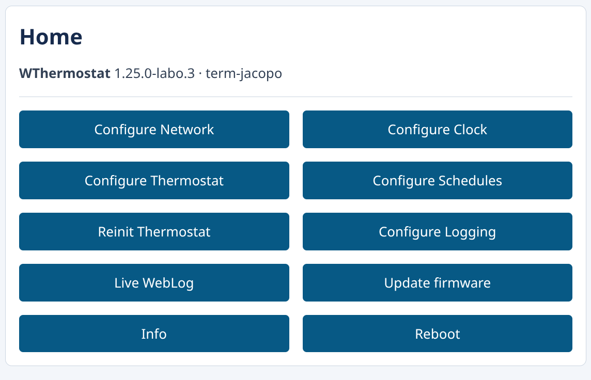

# WThermostat-Labo

Control a compatible **ESP8266 Beca, Moes or Qiumi thermostat** from a browser on your own network. Add Home Assistant or another MQTT client if you want automation. The thermostat's own controller continues to run its display, sensors and stored programs.

**[Download the latest stable firmware](https://github.com/labodj/WThermostatBeca-labo/releases/latest)** · [Check your hardware](#hardware-compatibility) · [Upgrade an existing thermostat](#upgrade-an-existing-thermostat) · [Version history](Changes.md)

[](https://github.com/labodj/WThermostatBeca-labo/actions/workflows/build.yml)

## Differences from the fashberg firmware

WThermostat-Labo builds on the local web interface, MQTT API and thermostat profiles from the original projects. If you already run the fashberg firmware, these are the changes you will notice. [Fashberg firmware](https://github.com/fashberg/WThermostatBeca) · [Original project by Klaus Ahrenberg](https://github.com/klausahrenberg/WThermostatBeca)

| When you use the thermostat | What the Labo fork improves |
|---|---|
| Change the temperature or program | A manual setpoint reaches the controller even when a program is active. ECO preserves your previous manual setting. Midnight periods, power changes and BAC cooling and fan states are reported correctly. |
| Open Home Assistant after a restart | Discovery restores the climate entity, supported sensors and diagnostics. The thermostat waits for valid controller data before showing availability and republishes discovery after a broker or Home Assistant restart. Existing supported entity IDs are preserved. |
| Lose Wi-Fi, MQTT or internet time | Wi-Fi reconnects, including to an optionally locked access point. MQTT backs off after a rejected login and retries pending updates. The clock runs for up to 48 hours after its last valid sync. Daylight-saving changes and the weekday sent to the panel stay consistent across midnight. |
| Save settings or lose power | Checked saves preserve recognized legacy settings, credentials and device identity. Two flash sectors hold successive settings snapshots. After an interrupted save the ESP can recover a complete snapshot. Saving identical settings avoids another erase. |
| Configure or diagnose a device | Administrator login protects configuration and OTA by default. Full-length Wi-Fi credentials are supported. Complete schedule forms, a live log, clearer status and a confirmation before MCU resync make local maintenance easier. |
| Run on a 1 MiB ESP8266 | Bounded web and MQTT responses, fixes for partial TCP writes and paced retries reduce work under memory pressure. Disabled temperature logs skip formatting. Release builds include verified images, checksums and matching debug symbols. |

## Hardware compatibility

Check the **Wi-Fi module and thermostat controller profile** before downloading. Similar-looking thermostats can contain different chips. This project targets the ESP8266 with a compatible MCU protocol and 1 MiB flash. A Wi-Fi logo or model suffix alone is insufficient.

| Family reported by the original projects | Profile |
|---|---|
| BHT-002, BHT-3000 / BTH-3000L, BHT-6000 (including GA, GB and GC Wi-Fi variants) | Heating |
| BAC-002-ALW, BAC-1000-ALW | Heating, cooling and fan |

The firmware replaces the software on the ESP8266. The separate MCU determines which sensors, relays and modes are available. Relay activity may be inferred from temperatures unless the device provides wired feedback. Check your revision and its wiring before installation. [Hardware guide](Installation.md) · [How the two controllers connect](docs/images/how-it-works.png)

## First installation and setup

1. **Starting from stock firmware?** Identify the module, back up the original firmware and follow the method for your hardware. Serial flashing requires disconnecting mains power. Wireless conversion applies only to certain older stock versions. [First-flash guide](Flashing.md)
2. Join the thermostat's setup network, normally `WThermostat-<chip-id>`, with AP key `12345678`. Open `http://192.168.4.1/` and enter your 2.4 GHz Wi-Fi settings.
3. Find the thermostat's new IP address in your router. Open it in a browser and sign in as **`admin` with the Wi-Fi password you saved**. Select the thermostat profile, temperature precision and time zone. Check that the programs shown match the panel. [Configuration guide](Configuration.md)

## Upgrade an existing thermostat

1. Record your current firmware, network settings and controller profile. Download **`wthermostat-<version>.bin`** and `SHA256SUMS` from the same release. Run `sha256sum --ignore-missing -c SHA256SUMS` in the download directory and check that the normal BIN reports `OK`.
2. Open **Firmware Update** in the device's web interface, check the available OTA space and upload the normal BIN. Keep the thermostat powered through the reboot.
3. Reopen the device, check the version on **Info**, then check the clock, stored programs and MQTT availability. Recognized legacy layouts migrate on a normal upgrade. AP fallback is enabled once on migration and subsequently follows your saved choice.

Use the **minimal** image only as a temporary bridge when the normal BIN will not fit. Upload the normal firmware immediately afterwards to restore thermostat communication, MQTT and the clock. Use a compressed `.bin.gz` only with an OTA uploader that supports gzip. ELF/MAP symbols are for diagnosis. An interruption while the bootloader installs firmware can require serial recovery. [Firmware downloads](https://github.com/labodj/WThermostatBeca-labo/releases/latest) · [Flashing and recovery](Flashing.md)

## Home Assistant

1. Connect the thermostat and Home Assistant's MQTT integration to the same broker.
2. Enable MQTT and Home Assistant discovery in **Network Configuration**. Use discovery prefix `homeassistant` and Birth topic `homeassistant/status` with payload `online`.
3. Open **Settings → Devices & services → MQTT**. BHT heating profiles offer `off`, `heat` and `auto`. BAC profiles offer `off`, `heat`, `cool` and `fan_only`, with scheduling exposed as a preset. Optional floor-temperature reporting depends on the model and settings. [MQTT integration](https://www.home-assistant.io/integrations/mqtt/) · [Device configuration](Configuration.md)



## Administration and security

Administration, firmware updates and live logs use HTTP Digest by default. WebThings GET requests are public on the LAN. Disabling administrator login lets anyone who can reach the device change settings or firmware. Use the device on a trusted network. MQTT uses its own broker credentials.

Wi-Fi accepts 8–63 password bytes or a 64-digit hexadecimal key. Hostnames and MQTT usernames support 32 bytes, MQTT passwords and base topics 64 bytes. Keep the saved-password boxes checked when changing other settings. Before downgrading, record your configuration and shorten any values the older firmware cannot store. An older build may read an earlier snapshot and use earlier credentials. [Login, saving and physical access recovery](Configuration.md#login-wi-fi-passwords-and-recovery)

## Optional BSSID lock and recovery

Use a BSSID lock if two access points share a name and the thermostat should always choose one. With AP fallback enabled, two continuous minutes without Wi-Fi or a reachable configured static gateway open a recovery AP while the thermostat keeps reconnecting. A BSSID lock also enables offline recovery. The automatic AP keeps administrator authentication enabled.

The normal recovery address is `192.168.4.1`. An overlapping station subnet selects `172.31.255.1` or `10.255.255.1`. Opening Network Configuration on the recovery AP refreshes the five-minute window. If you forget the administrator password, the **physical Wi-Fi setup gesture** on a supported controller opens a separate five-minute local recovery window. [Recovery instructions](Configuration.md#login-wi-fi-passwords-and-recovery)

## MQTT and WebThings API

<details>
<summary>Topics, HTTP endpoints and schedule examples</summary>

Replace `<base>` with the MQTT base topic configured on your thermostat. An empty command payload requests the current value. A single-property request produces a value reply once the device has a reading for that property.

| Topic below `<base>` | Purpose |
|---|---|
| `stat/things/thermostat/properties` | Thermostat state |
| `cmnd/things/thermostat/properties` | Request state or send a JSON object of writable properties |
| `cmnd/things/thermostat/properties/<property>` | Read one property with an empty payload, or set a writable property |
| `stat/things/thermostat/properties/<property>` | Single-property value. Direct requests also receive the legacy reply at `stat/things/thermostat/<property>` |
| `stat/things/thermostat/schedules`, `cmnd/things/thermostat/schedules` | Receive, request or update programs |
| `tele/LWT`, `tele/mcu` | MQTT connection and controller availability |
| `tele/log` | Diagnostic messages when enabled |

For example, publish an empty payload to `home/room/cmnd/things/thermostat/properties` and subscribe to `home/room/stat/things/thermostat/properties`. A JSON command such as `{"targetTemperature":22.0}` changes the setpoint. Outside ECO a user-set target switches a running program to manual. During ECO the reported target is read-only.

Schedule groups `w`, `a` and `u` each contain six periods. A partial update such as `{"w1h":"06:00","w1t":20.0}` changes one entry. Times must stay in order. A final period at `00:00` carries through midnight to the next day's first period. Programs become available after the controller reports them.

Read `GET /things/thermostat` to discover properties and allowed values for your profile. Read `GET /things/thermostat/properties` for current values or `GET /things/thermostat/schedules` for programs. The schedule endpoint returns HTTP 503 while waiting for the MCU. Writable property endpoints accept PUT with Digest authentication when login is enabled.

</details>

## Build and test

<details>
<summary>Build the firmware locally or run the regression suite</summary>

The validated host is Linux x86_64 with Python 3.14, g++ with 32-bit multilib, and Node.js for browser-script checks. The repository includes WAdapter and pins the ESP8266 toolchain and networking libraries.

```sh
git clone https://github.com/labodj/WThermostatBeca-labo.git
cd WThermostatBeca-labo
python3.14 -m venv .venv
. .venv/bin/activate
python -m pip install -r requirements-dev.txt
pio pkg install -e wthermostat
python -m unittest discover -s tests -v
CXX="g++ -m32" python -m unittest discover -s tests -v
pio run -e wthermostat -e wthermostat-minimal -e wthermostat-debug
python pio/check.py
```

Normal images are in `build_output/firmware/`. An optional `platformio_override.ini` can override the embedded version. The debug build sends UART logs and is intended for development boards. For extended static analysis run `python pio/analyze.py` with the tools listed in `requirements-analysis.txt`. To check discovery against Home Assistant, install `requirements-homeassistant-test.txt` in a separate Python 3.14 virtual environment and run `python tests/homeassistant_schema.py`. [Test map](tests/README.md) · [Build workflow](.github/workflows/build.yml) · [Dependency provenance](lib/WAdapter/UPSTREAM.md)

</details>

## Reporting a problem

Include the firmware version, thermostat model, Wi-Fi module, selected profile and what you observed on the panel, web interface or MQTT. Remove credentials from logs and screenshots. [Open an issue](https://github.com/labodj/WThermostatBeca-labo/issues)
